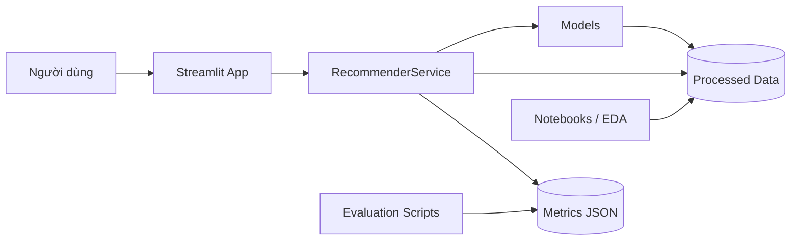

# AI Personalized Recommendation System

[](https://github.com/Huydcpy/AI-PERSONALIZED_RECOMMENDATION_SYSTEM-/actions/workflows/ci.yml)
[](https://www.python.org/downloads/release/python-3110/)
[](https://github.com/Huydcpy/AI-PERSONALIZED_RECOMMENDATION_SYSTEM-/releases)

Hệ thống gợi ý phim cá nhân hóa xây dựng trên **MovieLens 100K**, triển khai đầy đủ pipeline **data → model → service → giao diện Streamlit**. Dự án so sánh 5 phương pháp gợi ý trên cùng một protocol đánh giá, đồng thời phân tích cả **rating prediction** và **top-K ranking**.

## Tổng quan

- Pipeline dữ liệu tái lập: tải, tiền xử lý, validate và split `u1.base` / `u1.test` (80.000 / 20.000 ratings).
- 5 phương pháp: Popularity, Content-Based, Item-CF, SVD và Hybrid.
- Đánh giá rating bằng RMSE/MAE; đánh giá ranking bằng Precision@K, Recall@K, NDCG@K và Coverage@K.
- Ứng dụng Streamlit 6 trang: Home, User Profile, Recommendations, Similar Movies, Compare Methods, Evaluation.
- Kiểm soát leakage: chỉ fit và tạo lịch sử trên train; test chỉ dùng một lần để đánh giá.
- Fallback cold-start tập trung tại service layer, đảm bảo app luôn trả kết quả hợp lệ.
- 106 test tự động, lint bằng Ruff, CI chạy trên GitHub Actions.
- Release ổn định: [v1.0.1](https://github.com/Huydcpy/AI-PERSONALIZED_RECOMMENDATION_SYSTEM-/releases/tag/v1.0.1).

### Kết quả nổi bật

| Hạng mục | Kết quả chính |
|---|---|
| Rating prediction | SVD đạt RMSE `0.9561`, MAE `0.7524`; giảm `10,39%` RMSE và `12,82%` MAE so với Popularity |
| Ranking accuracy | Popularity dẫn NDCG@10 với `0.1747`; SVD đạt `0.1373` |
| Ranking coverage | Item-CF dẫn Coverage@10 với `0.5083`; Hybrid đạt `0.3151` |
| Hybrid | NDCG@10 `0.1096`, Coverage@10 `0.3151`; cân bằng accuracy và coverage |
| Ứng dụng | 6 trang Streamlit, hỗ trợ 5 phương pháp, so sánh model và xem metrics |

## Kiến trúc hệ thống

Luồng chính: **App → Service → Models**. Giao diện Streamlit không import trực tiếp `src.models`; mọi truy cập dữ liệu, model và metrics đều đi qua `RecommenderService`.



### Các lớp chính

| Lớp | Thư mục | Trách nhiệm |
|---|---|---|
| Data | `src/data` | Tải dữ liệu, chuẩn hóa schema, validate, lưu Parquet, chia train/test |
| Models | `src/models` | 5 recommender tuân theo contract chung `fit`, `recommend`, `similar_items` |
| Evaluation | `src/evaluation` | Rating metrics, ranking metrics, kiểm tra tính hợp lệ của kết quả |
| Service | `src/service` | `RecommenderService`: load dữ liệu, quản lý model, fallback, cung cấp metrics |
| Presentation | `app` | Streamlit Home và 5 trang chức năng |
| Scripts | `scripts` | Chạy baseline, SVD, ranking evaluation và smoke test |
| Reports | `reports` | Metrics JSON và hình ảnh đánh giá |

### Cấu trúc thư mục

```text
.
├── app/
│   ├── Home.py
│   ├── components/
│   └── pages/
├── configs/
│   └── config.yaml
├── data/
│   ├── raw/
│   └── processed/
├── docs/
│   ├── data_card.md
│   └── evaluation_protocol.md
├── models/
├── notebooks/
│   └── 01_eda.ipynb
├── reports/
│   ├── figures/
│   └── metrics/
├── scripts/
├── src/
│   ├── data/
│   ├── evaluation/
│   ├── models/
│   └── service/
├── tests/
├── notes/
├── pyproject.toml
├── requirements.txt
└── README.md
```

`data/raw`, `data/processed`, `models/` và các artifact sinh ra trong quá trình chạy không được commit.

## Phương pháp gợi ý

| Phương pháp | Method key | Mô tả ngắn |
|---|---|---|
| Popularity | `popularity` | Bayesian average với `m=50`; dùng làm baseline và fallback |
| Content-Based | `content_based` | Dựa trên 18 genre flags đã biết (bỏ `unknown`), cosine similarity và hồ sơ sở thích của user từ train |
| Item-based Collaborative Filtering | `item_cf` | Tương đồng item-item từ adjusted cosine, `k_neighbors=50`, trên tương tác train |
| Matrix Factorization | `svd` | Phân rã ma trận rating thành latent factors; dự đoán rating và xếp hạng |
| Hybrid | `hybrid` | Kết hợp SVD, Item-CF và Content-Based với trọng số riêng cho recommend và similar |

Hybrid dùng trọng số recommend `SVD 0.5 / Item-CF 0.3 / Content-Based 0.2`; trọng số similar `Item-CF 0.4 / SVD 0.3 / Content-Based 0.3`. Khi một component thiếu tín hiệu, service áp dụng fallback Popularity và giữ thang điểm native/fallback tách biệt.

## Dữ liệu

- **MovieLens 100K** từ GroupLens: 100.000 ratings, 943 users, 1.682 movies.
- Explicit feedback, thang điểm nguyên `1–5`.
- Split chuẩn `u1.base` / `u1.test`: 80.000 / 20.000 ratings.
- Độ thưa xấp xỉ `93,70%`.
- Nguồn: <https://files.grouplens.org/datasets/movielens/100k/>.
- Data card chi tiết: [`docs/data_card.md`](docs/data_card.md).

## Cài đặt và chạy

### Yêu cầu

- Python `3.11`
- pip
- Kết nối Internet ở lần tải dữ liệu đầu tiên

### 1. Clone repository

```bash
git clone https://github.com/Huydcpy/AI-PERSONALIZED_RECOMMENDATION_SYSTEM-.git
cd AI-PERSONALIZED_RECOMMENDATION_SYSTEM-
```

### 2. Tạo môi trường ảo và cài dependencies

```bash
python3.11 -m venv .venv
source .venv/bin/activate
pip install -r requirements.txt
```

Trên Windows, kích hoạt môi trường bằng `.venv\Scripts\activate`.

### 3. Chuẩn bị dữ liệu

```bash
python -m src.data.download
python -m src.data.preprocess
python -m src.data.splits
```

Dữ liệu sau xử lý được lưu trong `data/processed/` dưới dạng Parquet.

### 4. Chạy ứng dụng

```bash
streamlit run app/Home.py
```

Mặc định Streamlit mở giao diện tại `http://localhost:8501`.

### 5. Chạy test và kiểm tra chất lượng

```bash
pytest -q
ruff check .
```

### 6. Chạy đánh giá và smoke test

```bash
python scripts/run_baseline.py
python scripts/run_svd_eval.py
python scripts/run_ranking_eval.py

python scripts/smoke_content_based.py
python scripts/smoke_item_cf.py
python scripts/smoke_svd_hybrid.py
python scripts/smoke_surprise.py
```

Kết quả được ghi tại:

- `reports/metrics/baseline.json`
- `reports/metrics/svd.json`
- `reports/metrics/ranking.json`

## Đánh giá

### Protocol

- Fit model, tạo profile, similarity và lịch sử gợi ý **chỉ trên train**.
- Test chỉ dùng cho đánh giá cuối; không chọn model, hyperparameter, trọng số, threshold hoặc K từ test.
- Seed cố định `42`; các lần chạy lại chỉ nhằm kiểm tra tái lập.
- Ranking relevance: `rating >= 4.0`; `K = 5/10/20`, K chính là `10`.
- Ranking dùng candidate là toàn catalog trừ lịch sử train, không negative sampling.
- Macro-average trên **456 users** có relevant item; **487 users** không có relevant item bị bỏ qua.
- Coverage@10 tính trên toàn bộ **1.682 phim** trong catalog.
- Chi tiết protocol: [`docs/evaluation_protocol.md`](docs/evaluation_protocol.md).

### Rating prediction

| Model | RMSE | MAE | Nguồn |
|---|---:|---:|---|
| Popularity (Bayesian average) | 1.066985 | 0.863097 | `reports/metrics/baseline.json` |
| SVD | 0.956120 | 0.752447 | `reports/metrics/svd.json` |

SVD dùng `n_factors=100`, `n_epochs=20`, `lr_all=0.005`, `reg_all=0.02`, `seed=42`. So với Popularity, SVD giảm khoảng **10,39% RMSE** và **12,82% MAE** trên test.

### Ranking metrics

| Model | Precision@10 | Recall@10 | NDCG@10 | Coverage@10 |
|---|---:|---:|---:|---:|
| Popularity | 0.164474 | 0.070910 | 0.174714 | 0.023187 |
| Content-Based | 0.047368 | 0.022264 | 0.055068 | 0.237812 |
| Item-CF | 0.029167 | 0.018530 | 0.031481 | 0.508323 |
| SVD | 0.127851 | 0.048426 | 0.137267 | 0.105826 |
| Hybrid | 0.100658 | 0.040805 | 0.109632 | 0.315101 |

Nhận xét chính:

- Popularity dẫn NDCG@10 trên split này; SVD cải thiện rating prediction nhưng chưa vượt Popularity về ranking.
- Item-CF có Coverage@10 cao nhất nhưng NDCG@10 thấp nhất.
- Hybrid tăng coverage đáng kể so với SVD nhưng đánh đổi một phần NDCG@10.
- Không có phương pháp tốt nhất cho mọi mục tiêu; lựa chọn model phải gắn với metric và mục tiêu sản phẩm.

### Biểu đồ đánh giá

| Rating | Ranking accuracy |
|---|---|
|  |  |

| Coverage | Trade-off |
|---|---|
|  |  |

## Demo

### Dữ liệu mẫu

- **Users:** `1`, `196`, `405`
- **Movies:** `1` (Toy Story, 1995), `50` (Star Wars, 1977), `56` (Pulp Fiction, 1994)

### Luồng demo

1. Chọn user và phương pháp tại **Recommendations** để xem top-K gợi ý.
2. Chọn phim tại **Similar Movies** để xem các phim tương tự.
3. So sánh 5 phương pháp trên cùng một user tại **Compare Methods**.
4. Xem RMSE/MAE và ranking metrics tại **Evaluation**.
5. Kiểm tra hồ sơ, lịch sử và thống kê người dùng tại **User Profile**.

### Fallback cases

- **User mới, user không tồn tại hoặc không có lịch sử train:** fallback về Popularity; `method` và `reason` phản ánh kết quả thực tế.
- **User hoặc phim thiếu tín hiệu tương tác:** service áp dụng fallback phù hợp để vẫn trả danh sách hợp lệ.
- **`exclude_seen=True`:** không trả về phim user đã xem trong train.
- **Score khác thang đo:** không so sánh trực tiếp raw score giữa các phương pháp hoặc giữa native/fallback.

### Ảnh chụp giao diện

| Trang | Ảnh |
|---|---|
| Home |  |
| Recommendations |  |
| Similar Movies |  |
| Compare Methods |  |
| Evaluation |  |

## Tái lập và CI

Workflow CI tại `.github/workflows/ci.yml` chạy trên push/PR vào `main`, gồm:

1. Cài dependencies với Python 3.11.
2. `ruff check .`.
3. Kiểm tra boundary: `app/` không import trực tiếp `src.models`.
4. Tải và chuẩn bị dữ liệu.
5. `pytest -q` (106 tests).
6. Ranking evaluation, SVD evaluation và các smoke test.

Để tái lập toàn bộ kết quả từ repository root:

```bash
python -m src.data.download
python -m src.data.preprocess
python -m src.data.splits
pytest -q
ruff check .
python scripts/run_baseline.py
python scripts/run_svd_eval.py
python scripts/run_ranking_eval.py
```

Raw data, processed data, model artifacts và metrics tạm không được commit; metrics chính thức được lưu trong `reports/metrics/`.

## Hạn chế

- MovieLens 100K được thu thập giai đoạn 1997–1998, không phản ánh đầy đủ sở thích hiện tại.
- Chỉ có explicit feedback; chưa khai thác implicit signals như click, thời gian xem hoặc lượt bỏ qua.
- Đặc trưng nội dung chỉ dựa trên genre, chưa dùng mô tả, diễn viên, đạo diễn hoặc poster embedding.
- Dữ liệu thưa và có popularity bias; các model có trade-off giữa rating accuracy, ranking accuracy và coverage.
- Kết quả chính dùng một split/seed cố định; chưa thực hiện cross-validation đầy đủ.
- Thang điểm `score` khác nhau giữa các phương pháp nên chỉ so sánh thứ hạng và metric, không so sánh raw score.

## Hướng phát triển

- Bổ sung implicit feedback, negative sampling và mô hình BPR/ALS.
- Thử nghiệm Neural CF, AutoRec, VAE-CF, LightGCN hoặc two-tower.
- Dùng metadata phong phú và embedding cho Content-Based.
- Học trọng số Hybrid theo user/context thay vì trọng số cố định.
- Đánh giá cross-validation, bootstrap confidence interval và kiểm định thống kê.
- Đo fairness, diversity, novelty và exposure bias.
- Cải thiện cold-start, caching, logging/monitoring và A/B testing.

## Nhóm thực hiện

| Thành viên | Vai trò | Phụ trách chính |
|---|---|---|
| Huy (Nhóm trưởng) | Integration & Final report | Tích hợp, kiểm chứng, báo cáo tổng hợp, review/merge, điều phối demo |
| Nguyễn Quốc Phong | Data & Evaluation | Pipeline dữ liệu, protocol đánh giá, chạy metrics, phân tích kết quả và biểu đồ |
| Phạm Văn Linh | Product & Demo | Ứng dụng Streamlit, trải nghiệm người dùng, README, screenshot, kịch bản demo/slide |

## Tài liệu

- Báo cáo Day 5: [`notes/day5_report.md`](notes/day5_report.md)
- Đánh giá cuối: [`notes/day5_eval.md`](notes/day5_eval.md)
- Protocol đánh giá: [`docs/evaluation_protocol.md`](docs/evaluation_protocol.md)
- Data card: [`docs/data_card.md`](docs/data_card.md)
- Kịch bản demo: [`notes/demo_script.md`](notes/demo_script.md)
- Dàn ý slide: [`notes/day5_slides.md`](notes/day5_slides.md)
- Metrics: `reports/metrics/baseline.json`, `reports/metrics/svd.json`, `reports/metrics/ranking.json`
- Release: [`v1.0.1`](https://github.com/Huydcpy/AI-PERSONALIZED_RECOMMENDATION_SYSTEM-/releases/tag/v1.0.1)
- Repository: <https://github.com/Huydcpy/AI-PERSONALIZED_RECOMMENDATION_SYSTEM->

## Ghi nhận

- Dữ liệu MovieLens 100K do GroupLens Research, University of Minnesota cung cấp. Vui lòng đọc điều khoản sử dụng trong `data/raw/ml-100k/README` sau khi tải dữ liệu.
- Dự án sử dụng thư viện [Surprise](https://surpriselib.com/) cho SVD và [Streamlit](https://streamlit.io/) cho giao diện demo.
- Mã nguồn được thực hiện cho mục đích học tập và báo cáo cuối kỳ môn Học máy nâng cao. Vui lòng liên hệ nhóm trước khi tái sử dụng ngoài phạm vi học tập.
