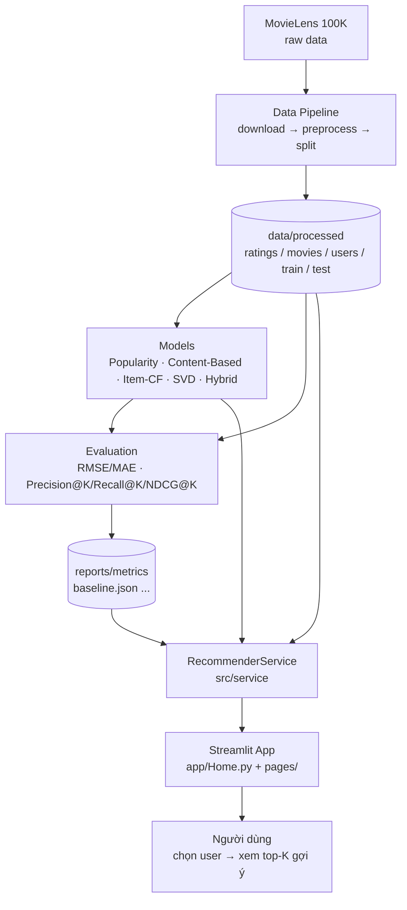

# AI Personalized Recommendation System

Hệ thống gợi ý phim cá nhân hóa xây dựng trên bộ dữ liệu **MovieLens 100K**, hướng tới một luồng end-to-end hoàn chỉnh: **data → model → service → giao diện Streamlit**.

Mục tiêu của dự án:

- Xây dựng pipeline dữ liệu sạch, chia train/test chống leakage.
- Triển khai nhiều phương pháp gợi ý: Popularity, Content-Based, Item-CF, SVD, Hybrid.
- Đánh giá bằng rating metrics (RMSE/MAE) và ranking metrics (Precision@K, Recall@K, NDCG@K).
- Cung cấp giao diện web để chọn user, xem hồ sơ, nhận top-K gợi ý và so sánh phương pháp.

## Công nghệ sử dụng

| Thành phần | Công nghệ |
|---|---|
| Ngôn ngữ | Python 3.11 |
| Xử lý dữ liệu | pandas, NumPy, PyArrow (Parquet) |
| Machine Learning | scikit-surprise, scikit-learn, SciPy |
| Giao diện | Streamlit |
| Trực quan hóa | Matplotlib, Seaborn |
| Kiểm thử & chất lượng code | pytest, ruff |
| CI | GitHub Actions |
| Cấu hình | YAML (`configs/config.yaml`) |

## Kiến trúc tổng quan

Dự án được tổ chức theo kiến trúc phân lớp, tách biệt rõ ràng giữa dữ liệu, model, đánh giá, service và giao diện.



### Các lớp chính

1. **Data layer (`src/data`)** — Tải dữ liệu, chuẩn hóa schema, validate, lưu Parquet và chia train/test (`u1.base` / `u1.test`).
2. **Model layer (`src/models`)** — Mỗi recommender implement chung contract `Recommender` (Protocol), trả về danh sách `Recommendation` gồm `movie_id`, `title`, `score`, `method`, `reason`.
3. **Evaluation layer (`src/evaluation`)** — Tính rating metrics và ranking metrics; kết quả ghi ra `reports/metrics/`.
4. **Service layer (`src/service`)** — `RecommenderService` là điểm truy cập duy nhất cho UI: load dữ liệu, quản lý model, xử lý user không tồn tại, trả metrics.
5. **Presentation layer (`app/`)** — Streamlit app gồm 5 trang: Home, User Profile, Recommendations, Similar Movies, Compare Methods, Evaluation.

### Nguyên tắc thiết kế

- **Tách biệt UI và model**: app chỉ gọi qua `RecommenderService`, không import trực tiếp `src.models`.
- **Contract thống nhất**: mọi model tuân theo `src/models/base.py`.
- **Chống leakage**: test chỉ dùng một lần để đánh giá, không dùng để fit/tuning; lịch sử user chỉ lấy từ train.
- **Tái lập được**: seed cố định `42`, cấu hình tập trung trong `configs/`.
- **Cache**: `st.cache_data` cho dữ liệu/JSON, `st.cache_resource` cho service.

## Cấu trúc repository

```text
.
├── .github/
│   └── workflows/ci.yml    # Lint + test trên GitHub Actions
├── app/                    # Streamlit app (Home + pages + components)
├── configs/                # Cấu hình dự án (config.yaml)
├── data/
│   ├── raw/                # Dữ liệu gốc MovieLens (không commit)
│   └── processed/          # Parquet đã xử lý (không commit)
├── docs/                   # Data card, evaluation protocol
├── models/                 # Model artifacts (không commit)
├── notebooks/              # EDA, thử nghiệm
├── reports/
│   ├── figures/            # Biểu đồ EDA
│   └── metrics/            # Kết quả đánh giá (JSON)
├── scripts/                # run_baseline.py, smoke_surprise.py
├── src/
│   ├── data/               # download, preprocess, splits
│   ├── models/             # base contract + các recommender
│   ├── evaluation/         # rating & ranking metrics
│   └── service/            # RecommenderService
├── tests/                  # Unit tests
├── requirements.txt
└── README.md
```

## Dataset

- **MovieLens 100K** (GroupLens): 100.000 ratings, 943 users, 1.682 movies.
- Đánh giá tường minh (explicit feedback), thang điểm 1–5.
- Split chuẩn: `u1.base` (80.000) / `u1.test` (20.000).
- Độ thưa: `1 - 100000 / (943 × 1682) ≈ 93,7%`.
- Nguồn: <https://files.grouplens.org/datasets/movielens/ml-100k.zip>
- License: theo điều khoản sử dụng của GroupLens.

## Cài đặt

Yêu cầu Python 3.11.

```bash
python3.11 -m venv .venv
source .venv/bin/activate
pip install -r requirements.txt
```

> Nếu cài `scikit-surprise` lỗi, thử: `pip install "numpy<2.0" cython` rồi cài lại `scikit-surprise==1.1.4`.

## Chạy dự án

```bash
# 1. Tải và xử lý dữ liệu
python -m src.data.download
python -m src.data.preprocess
python -m src.data.splits

# 2. Đánh giá rating prediction
python scripts/run_baseline.py
python scripts/run_svd_eval.py

# 3. Đánh giá ranking
python scripts/run_ranking_eval.py

# 4. Smoke test
python scripts/smoke_item_cf.py
python scripts/smoke_svd_hybrid.py
python scripts/smoke_surprise.py

# 5. Chạy test và lint (CI)
pytest -q
ruff check .

# 6. Chạy giao diện
streamlit run app/Home.py
```

## Kết quả Day 1

| Model | RMSE | MAE | Ghi chú |
|---|---|---|---|
| Popularity (Bayesian average) | 1.06698 | 0.86310 | Baseline, dự đoán theo điểm phổ biến |

Chi tiết trong `reports/metrics/baseline.json`.

## Roadmap

| Ngày | Nội dung | Trạng thái |
|---|---|---|
| Day 1 | Data pipeline, popularity baseline, rating metrics (RMSE/MAE), Streamlit app | Hoàn thành |
| Day 2 | Content-Based Filtering, Similar Movies và Compare Methods; kiểm chứng local trong notes/day2_eval.md | Hoàn thành |
| Day 3 | Item-CF, ranking metrics (Precision@K, Recall@K, NDCG@K), cập nhật giao diện (Recommendations, Similar Movies, Compare Methods, Evaluation) | Hoàn thành |
| Day 4 | SVD & Hybrid, mở rộng Compare Methods/Evaluation/Home/Service cho 5 phương pháp | Hoàn thành |
| Day 5 | Đánh giá, báo cáo và demo | Kế hoạch |

## Hạn chế

- Dữ liệu MovieLens 100K có từ 1997–1998, không phản ánh sở thích hiện tại.
- Chỉ có explicit feedback, không có implicit signals (click, thời gian xem).
- Genre thô, chưa khai thác nội dung phim (mô tả, poster, diễn viên).
- Dữ liệu thưa (~93,7%) và có popularity bias.

## Day 2 results

Content-Based is available in the service, Recommendations, Similar Movies, and Compare Methods. It uses 18 known genres, L2 normalization, cosine similarity, and train-only profiles weighted by max(rating - 3, 0). Cold-start users, zero-genre movies, and short result lists use Popularity fallback. Cards show the actual method and reason.

Method key la `content_based` (goi qua `service.recommend(user_id, method="content_based", k=k)` va mac dinh `service.similar_items(movie_id, k=k)`). Ly do hien thi: `Khop the loai: ...` cho goi y theo user va `Cung the loai: ...` cho Similar Movies.

User `196`, Top-5 goi y Content-Based (`method="content_based"`, `k=5`, `exclude_seen=True`):

| movie_id | Title | Score | Reason |
|---|---|---|---|
| 34 | Doom Generation, The (1995) | 0.9136 | Khop the loai: Comedy, Drama |
| 45 | Eat Drink Man Woman (1994) | 0.9136 | Khop the loai: Comedy, Drama |
| 47 | Ed Wood (1994) | 0.9136 | Khop the loai: Comedy, Drama |
| 65 | What's Eating Gilbert Grape (1993) | 0.9136 | Khop the loai: Comedy, Drama |
| 93 | Welcome to the Dollhouse (1995) | 0.9136 | Khop the loai: Comedy, Drama |

Phim `1` — Toy Story (1995), Top-5 phim tuong tu (`similar_items(movie_id=1, k=5)`):

| movie_id | Title | Score | Reason |
|---|---|---|---|
| 422 | Aladdin and the King of Thieves (1996) | 1.0000 | Cung the loai: Animation, Children, Comedy |
| 95 | Aladdin (1992) | 0.8660 | Cung the loai: Animation, Children, Comedy |
| 1219 | Goofy Movie, A (1995) | 0.8660 | Cung the loai: Animation, Children, Comedy |
| 63 | Santa Clause, The (1994) | 0.8165 | Cung the loai: Children, Comedy |
| 94 | Home Alone (1990) | 0.8165 | Cung the loai: Children, Comedy |

Run `python scripts/smoke_content_based.py` and `python -m pytest -q`. On this workspace, use `.\.venv\python.exe` in place of `python`.

User 1 top-5: 47: Ed Wood (1994); 65: What's Eating Gilbert Grape (1993); 150: Swingers (1996); 236: Citizen Ruth (1996); 316: As Good As It Gets (1997).

Toy Story similar top-5: 422: Aladdin and the King of Thieves (1996); 95: Aladdin (1992); 1219: Goofy Movie, A (1995); 63: Santa Clause, The (1994); 94: Home Alone (1990).

Genre-only features are coarse and often tie. Content and Popularity scores have different scales. No Content-Based RMSE/MAE is claimed; Day 1 baseline metrics remain unchanged. Audit and examples: [Day 2 evaluation](notes/day2_eval.md). Review record: [Day 2 review](notes/day2_review.md). Screenshot: [Home](reports/figures/day2_home.png). CI passed at commit `7804b97`.

## Kết quả Day 3

### Ranking Metrics (3 models)

Train-only fit; test relevance rating >= 4.0, K=5/10/20; macro-average over 456 users, 487 users without relevant items skipped.

| Model | Precision@5 | Precision@10 | Recall@10 | NDCG@10 | Coverage@10 |
|---|---:|---:|---:|---:|---:|
| popularity | 0.163158 | 0.164474 | 0.070910 | 0.174714 | 0.023187 |
| content_based | 0.058772 | 0.047368 | 0.022264 | 0.055068 | 0.237812 |
| item_cf | 0.028947 | 0.029167 | 0.018530 | 0.031481 | 0.508323 |

Popularity has the highest NDCG@10; Item-CF has the highest coverage. Full results: `reports/metrics/ranking.json`. No hyperparameters were tuned on test.

Item-CF uses adjusted cosine on user-centered train ratings and keeps 50 neighbors per item. Recommendations return clipped predicted ratings in [1,5]; similar movies return cosine scores. Cold-start and missing-signal cases use Popularity fallback with explicit method/reason.


### Item-CF user 196

| movie_id | Title | Score | Method |
|---|---|---:|---|
| 127 | Godfather, The (1972) | 5.000000 | item_cf |
| 154 | Monty Python's Life of Brian (1979) | 5.000000 | item_cf |
| 182 | GoodFellas (1990) | 5.000000 | item_cf |
| 293 | Donnie Brasco (1997) | 5.000000 | item_cf |
| 311 | Wings of the Dove, The (1997) | 5.000000 | item_cf |

### Item-CF similar to Toy Story (1)

| movie_id | Title | Score | Method |
|---|---|---:|---|
| 174 | Raiders of the Lost Ark (1981) | 0.232298 | item_cf |
| 50 | Star Wars (1977) | 0.218316 | item_cf |
| 28 | Apollo 13 (1995) | 0.205302 | item_cf |
| 318 | Schindler's List (1993) | 0.198516 | item_cf |
| 181 | Return of the Jedi (1983) | 0.197914 | item_cf |

Sparse data, cold-start cases and predictions clipped at 5 can reduce ranking quality and produce ties. Item-CF precision is below Popularity on this split. Day 1 baseline rating metrics remain unchanged.

Report and all 3-user/3-movie examples: [Day 3 report](notes/day3_report.md). Protocol and results: [Day 3 evaluation](notes/day3_eval.md). Integration review: [Day 3 review](notes/day3_review.md).

## Kết quả Day 4

### Rating Prediction (Popularity vs SVD)

| Model | RMSE | MAE | Ghi chú |
|---|---:|---:|---|
| Popularity (Bayesian average) | 1.06698 | 0.86310 | Giữ nguyên kết quả Day 1 (`reports/metrics/baseline.json`) |
| SVD | 0.956120 | 0.752447 | `n_factors=100`, `n_epochs=20`, `lr_all=0.005`, `reg_all=0.02`; fit train-only |

SVD giảm khoảng 10,39% RMSE và 12,82% MAE so với Popularity. Không tune hyperparameter trên test; kết quả thật nằm trong `reports/metrics/svd.json`.

### Ranking Metrics (5 model)

Dữ liệu 5 model lấy từ `reports/metrics/ranking.json` (test relevance rating >= 4.0; macro-average over 456 users, 487 users skipped; K=5/10/20). Chạy `python scripts/run_ranking_eval.py` để tái lập.

| Model | Precision@5 | Precision@10 | Recall@10 | NDCG@10 | Coverage@10 |
|---|---:|---:|---:|---:|---:|
| Popularity | 0.163158 | 0.164474 | 0.070910 | 0.174714 | 0.023187 |
| Content-Based | 0.058772 | 0.047368 | 0.022264 | 0.055068 | 0.237812 |
| Item-CF | 0.028947 | 0.029167 | 0.018530 | 0.031481 | 0.508323 |
| SVD | 0.136842 | 0.127851 | 0.048426 | 0.137267 | 0.105826 |
| Hybrid | 0.108333 | 0.100658 | 0.040805 | 0.109632 | 0.315101 |

Popularity dẫn đầu NDCG@10; Item-CF dẫn đầu Coverage@10. SVD cải thiện dự đoán rating nhưng không vượt Popularity về ranking. Hybrid nằm giữa SVD và Content-Based/Item-CF về NDCG@10, đồng thời tăng coverage so với SVD.

### Ví dụ Top-5 gợi ý và Similar Movies (SVD, Hybrid)

Chạy `python scripts/smoke_svd_hybrid.py` để tái lập. Giao diện Streamlit (Recommendations, Similar Movies, Compare Methods) hiển thị `method`, `score`, `reason` thực tế từ service.

**SVD — user 196, Top-5 gợi ý (`k=5`, `exclude_seen=True`; reason: Dự đoán theo sở thích cá nhân (SVD))**

| movie_id | Title | Score | Method |
|---|---|---:|---|
| 483 | Casablanca (1942) | 4.287311 | svd |
| 408 | Close Shave, A (1995) | 4.278069 | svd |
| 169 | Wrong Trousers, The (1993) | 4.265532 | svd |
| 318 | Schindler's List (1993) | 4.255841 | svd |
| 923 | Raise the Red Lantern (1991) | 4.253564 | svd |

**Hybrid — user 196, Top-5 gợi ý (`k=5`, `exclude_seen=True`; reason: Kết hợp SVD + Item-CF + Content-Based)**

| movie_id | Title | Score | Method |
|---|---|---:|---|
| 127 | Godfather, The (1972) | 0.602944 | hybrid |
| 481 | Apartment, The (1960) | 0.500000 | hybrid |
| 483 | Casablanca (1942) | 0.500000 | hybrid |
| 408 | Close Shave, A (1995) | 0.487263 | hybrid |
| 169 | Wrong Trousers, The (1993) | 0.469986 | hybrid |

**SVD — similar to Toy Story (movie 1), Top-5 (reason: Cùng gu người dùng (SVD))**

| movie_id | Title | Score | Method |
|---|---|---:|---|
| 45 | Eat Drink Man Woman (1994) | 0.405460 | svd |
| 378 | Miracle on 34th Street (1994) | 0.348896 | svd |
| 979 | Trigger Effect, The (1996) | 0.343406 | svd |
| 174 | Raiders of the Lost Ark (1981) | 0.339268 | svd |
| 1459 | Madame Butterfly (1995) | 0.335045 | svd |

**Hybrid — similar to Toy Story (movie 1), Top-5 (reason: Kết hợp độ tương đồng SVD + Item-CF + Content-Based)**

| movie_id | Title | Score | Method |
|---|---|---:|---|
| 174 | Raiders of the Lost Ark (1981) | 0.606314 | hybrid |
| 50 | Star Wars (1977) | 0.356538 | hybrid |
| 28 | Apollo 13 (1995) | 0.316084 | hybrid |
| 45 | Eat Drink Man Woman (1994) | 0.312127 | hybrid |
| 95 | Aladdin (1992) | 0.303779 | hybrid |

Report: [Day 4 report](notes/day4_report.md). Protocol and full examples: [Day 4 evaluation](notes/day4_eval.md). Integration review: [Day 4 review](notes/day4_review.md). Raw metrics: `reports/metrics/svd.json`, `reports/metrics/ranking.json`.

### Hạn chế (Day 4)

- **SVD** cần đủ dữ liệu rating để latent factors ổn định; người dùng/phim ít tín hiệu có thể cho dự đoán kém tin cậy.
- **Hybrid** phụ thuộc chất lượng và khả năng sẵn sàng của các component (SVD, Item-CF, Content-Based).
- **Cold-start** (user/phim mới hoặc thiếu tín hiệu) fallback về Popularity; `method`/`reason` hiển thị phản ánh thực tế từ service.
- **Thang đo score khác nhau** giữa các phương pháp (Popularity: count/rating; Content-Based: cosine [0,1]; Item-CF/SVD: rating [1,5]; Hybrid: blended score [0,1]) nên không so sánh trực tiếp điểm số.

### Smoke test & CI
```bash
python scripts/run_svd_eval.py
python scripts/run_ranking_eval.py
python scripts/smoke_item_cf.py
python scripts/smoke_svd_hybrid.py
pytest -q
ruff check .
```

CI chạy toàn bộ test, ranking evaluation, SVD rating evaluation và các smoke test (Content-Based, Item-CF, SVD/Hybrid, Surprise).

On Windows, building scikit-surprise 1.1.4 requires Microsoft C++ Build Tools. MSVC and Windows SDK are now installed locally; scikit-surprise 1.1.4 built successfully and the full suite (106 tests) passes after integrating the remote feature branch. The Surprise smoke script passes with RMSE 0.9540. If Windows console encoding fails on Vietnamese output, set `$env:PYTHONIOENCODING = "utf-8"` before running the script in PowerShell.
