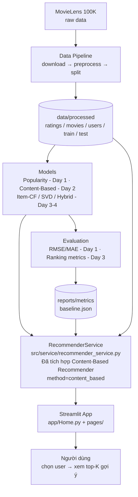

# AI-PERSONALIZED_RECOMMENDATION_SYSTEM

Hệ thống gợi ý phim cá nhân hóa xây dựng trên bộ dữ liệu **MovieLens 100K**, theo luồng end-to-end: **data → model → service → giao diện Streamlit**. Hệ thống đã tích hợp **Content-Based Recommender** (Day 2) bên cạnh Popularity (Day 1).

## Kiến trúc tổng quan

Dự án được tổ chức theo kiến trúc phân lớp, tách biệt rõ ràng giữa dữ liệu, model, đánh giá, service và giao diện.



### Trạng thái các phương pháp

- Popularity (Đã có - Day 1)
- Content-Based (Đã có - Day 2)
- Item-CF / SVD / Hybrid (Sẽ làm ở Day 3–4)

### Các lớp chính

1. **Data layer (`src/data`)** — Tải dữ liệu, chuẩn hóa schema, validate và chia train/test.
2. **Model layer (`src/models`)** — Mỗi recommender implement chung contract `Recommendation` (`movie_id`, `title`, `score`, `method`, `reason`). Day 2 đã tích hợp **Content-Based Recommender** (`src/models/content_based.py` ở branch `feat/content-based`) vào service với key `content_based`.
3. **Evaluation layer (`src/evaluation`)** — Tính rating metrics (RMSE/MAE) ở Day 1; ranking metrics (Precision@K, Recall@K, NDCG@K) sẽ bổ sung ở Day 3.
4. **Service layer (`src/service`)** — `RecommenderService` là điểm truy cập duy nhất cho UI: load dữ liệu, quản lý model (Popularity + Content-Based), xử lý user/phim không tồn tại và fallback, trả metrics.
5. **Presentation layer (`app/`)** — Streamlit app gồm Home, User Profile, Recommendations, Similar Movies, Compare Methods, Evaluation.

### Nguyên tắc thiết kế

- **Tách biệt UI và model**: app chỉ gọi qua `RecommenderService`, không import trực tiếp `src.models`.
- **Contract thống nhất**: mọi model tuân theo `src/models/base.py`.
- **Chống leakage**: chỉ dùng train để tạo hồ sơ người dùng (user profile); test chỉ dùng một lần để đánh giá.
- **Cache**: `@st.cache_data` cho dữ liệu/JSON, `@st.cache_resource` cho service.

## Cấu trúc dự án
```text
.
├── app/                  # Ứng dụng Streamlit (pages, components)
├── configs/              # Cấu hình dự án (config.yaml)
├── data/                 # Dữ liệu thô (raw) và đã xử lý (processed)
├── models/               # Mô hình đã huấn luyện (.joblib, .pkl) - không commit
├── notebooks/            # Jupyter Notebooks cho EDA và thử nghiệm
├── reports/              # Báo cáo, biểu đồ (figures) và chỉ số đánh giá (metrics)
├── scripts/              # Các kịch bản chạy tự động
├── src/                  # Mã nguồn chính (data, models, evaluation, service)
├── tests/                # Unit tests
└── docs/                 # Tài liệu dự án
```

## Cài đặt
```bash
pip install -r requirements.txt
```

## Chạy ứng dụng
```bash
streamlit run app/Home.py
```

## Kết quả Day 1

> Các chỉ số RMSE/MAE của Popularity ở Day 1 dưới đây được **giữ nguyên, không ghi đè** bởi kết quả Day 2. Day 2 chưa tính RMSE/MAE mới cho Content-Based; ranking metrics sẽ bổ sung ở Day 3.

| Model | RMSE | MAE | Ghi chú |
|---|---|---|---|
| Popularity (Bayesian average) | 1.06698 | 0.86310 | Baseline Day 1, dự đoán theo điểm phổ biến |

Chi tiết trong `reports/metrics/baseline.json` (`rmse=1.0669849661484991`, `mae=0.8630965089060417`, `n_test=20000`, `train_size=80000`, `seed=42`).

## Kết quả Day 2

### Phương pháp Content-Based

Content-Based Filtering dùng **TF-IDF / Cosine Similarity dựa trên Genres**:

- Mỗi phim được biểu diễn bằng vector đặc trưng thể loại (Genres) — ma trận phim × thể loại, chuẩn hóa L2; các thể loại được trọng số theo mức độ đặc trưng (TF-IDF-style weighting trên Genres).
- Hồ sơ người dùng (user profile) được xây dựng từ các phim đã rating trong train, trọng số dương theo rating (`max(rating - 3.0, 0.0)`), rồi chuẩn hóa.
- Điểm gợi ý (score) là **Cosine Similarity** giữa user profile và vector Genres của phim ứng viên; chỉ giữ phim có `score > 0`, loại phim đã xem khi `exclude_seen=True`, sắp xếp giảm dần theo score.
- `similar_items` dùng cùng Cosine Similarity trên vector Genres: lấy vector của phim gốc, loại chính nó, trả phim cùng thể loại nhất.
- Lý do hiển thị: `Khớp thể loại: ...` cho gợi ý theo user và `Cùng thể loại: ...` cho Similar Movies.
- Method key: `content_based` (gọi qua `service.recommend(user_id, method="content_based", k=k)` và mặc định `service.similar_items(movie_id, k=k)`).

### Ví dụ Top-5 gợi ý cho 1 user

User `196`, Top-5 gợi ý Content-Based (`method="content_based"`, `k=5`, `exclude_seen=True`):

| movie_id | Title | Score | Reason |
|---|---|---|---|
| 34 | Doom Generation, The (1995) | 0.9136 | Khớp thể loại: Comedy, Drama |
| 45 | Eat Drink Man Woman (1994) | 0.9136 | Khớp thể loại: Comedy, Drama |
| 47 | Ed Wood (1994) | 0.9136 | Khớp thể loại: Comedy, Drama |
| 65 | What's Eating Gilbert Grape (1993) | 0.9136 | Khớp thể loại: Comedy, Drama |
| 93 | Welcome to the Dollhouse (1995) | 0.9136 | Khớp thể loại: Comedy, Drama |

### Ví dụ Similar Movies cho 1 phim

Phim `1` — Toy Story (1995), Top-5 phim tương tự (`similar_items(movie_id=1, k=5)`):

| movie_id | Title | Score | Reason |
|---|---|---|---|
| 422 | Aladdin and the King of Thieves (1996) | 1.0000 | Cùng thể loại: Animation, Children, Comedy |
| 95 | Aladdin (1992) | 0.8660 | Cùng thể loại: Animation, Children, Comedy |
| 1219 | Goofy Movie, A (1995) | 0.8660 | Cùng thể loại: Animation, Children, Comedy |
| 63 | Santa Clause, The (1994) | 0.8165 | Cùng thể loại: Children, Comedy |
| 94 | Home Alone (1990) | 0.8165 | Cùng thể loại: Children, Comedy |

### Hạn chế của Content-Based (Day 2)

- **Genre-only**: mô hình chỉ dùng đặc trưng Genres, chưa dùng title, mô tả, diễn viên hay nội dung khác, nên gợi ý còn thô và nhiều phim cùng thể loại có score bằng nhau.
- **Cold-start problem**: user mới/chưa có rating (hoặc chỉ rating thấp) và phim chưa có thể loại không tạo được profile/vector nội dung, nên không có tín hiệu để gợi ý theo nội dung.
- **Popularity fallback**: các trường hợp cold-start hoặc thiếu thể loại được xử lý bằng Popularity fallback — trả gợi ý phổ biến với `method="popularity"` và reason ghi rõ fallback, thay vì crash app.

## Roadmap

| Ngày | Nội dung | Trạng thái |
|---|---|---|
| Day 1 | Data pipeline, Popularity baseline, rating metrics (RMSE/MAE), Streamlit app | Đã có - Day 1 |
| Day 2 | Content-Based Filtering (TF-IDF / Cosine Similarity dựa trên Genres), trang Similar Movies, Compare Methods và Home cập nhật | Đã có - Day 2 (Đã hoàn thành) |
| Day 3 | Item-CF, ranking metrics (Precision@K, Recall@K, NDCG@K), đánh giá định lượng cho Content-Based | Sẽ làm ở Day 3 |
| Day 4 | SVD, Hybrid, trang so sánh phương pháp đầy đủ | Sẽ làm ở Day 3–4 |
| Day 5 | Hoàn thiện đánh giá, báo cáo và demo | Sẽ làm ở Day 5 |

## Kiểm thử (Smoke test)

```bash
# Unit test
pytest -q

# Lint
ruff check .

# Kiểm tra app không import trực tiếp model (kết quả mong đợi: không có dòng nào được in ra)
grep -R "from src.models" app/
if grep -R "from src.models" app/; then exit 1; fi

# Smoke test service: Content-Based cho user 196, Top-5
python -c "from src.service.recommender_service import RecommenderService; s=RecommenderService(); print(s.recommend(196, method='content_based', k=5))"

# Chạy giao diện
streamlit run app/Home.py
```
