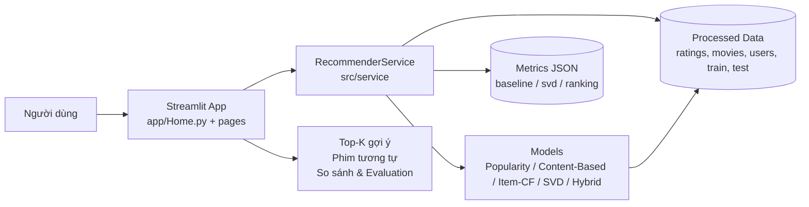
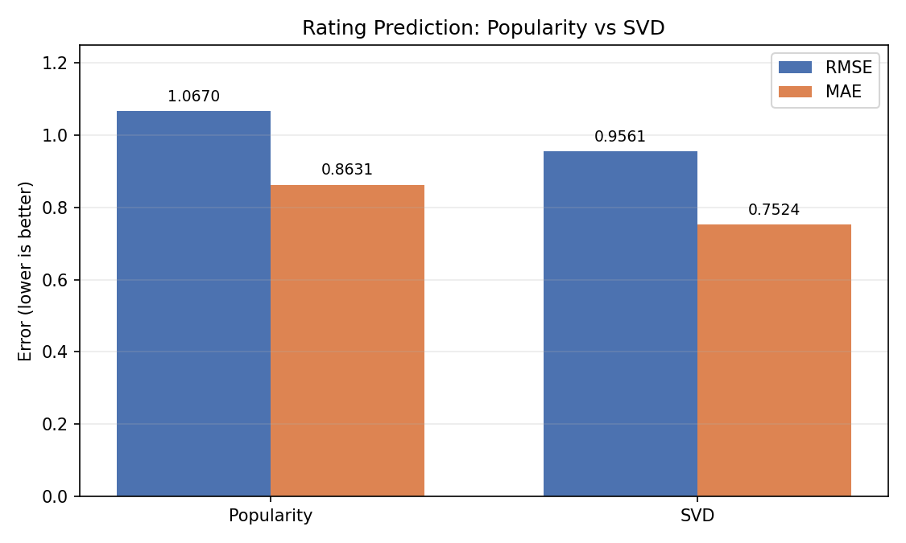
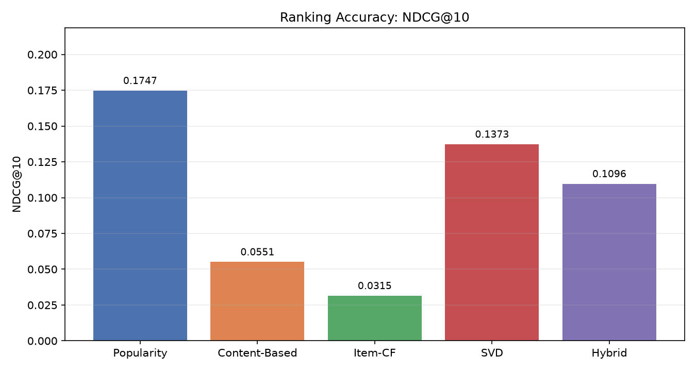
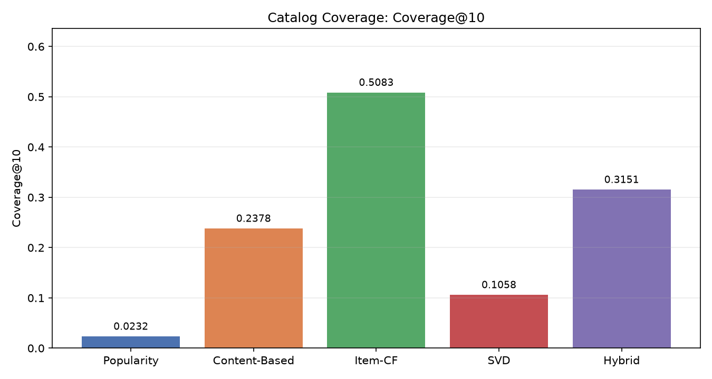
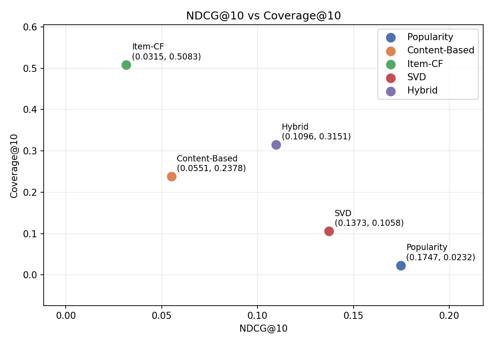
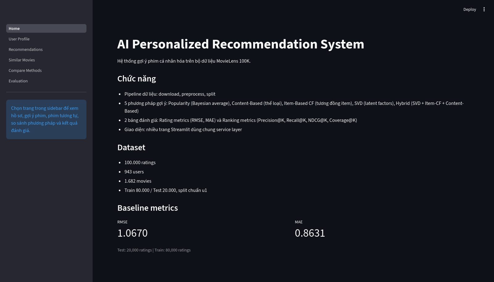
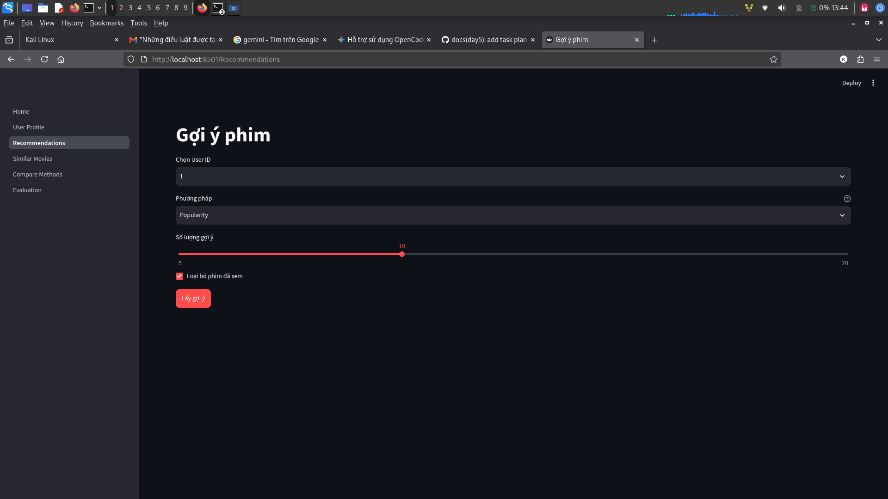
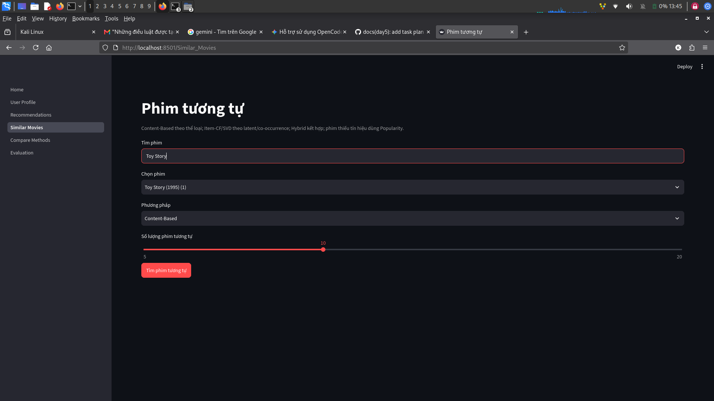
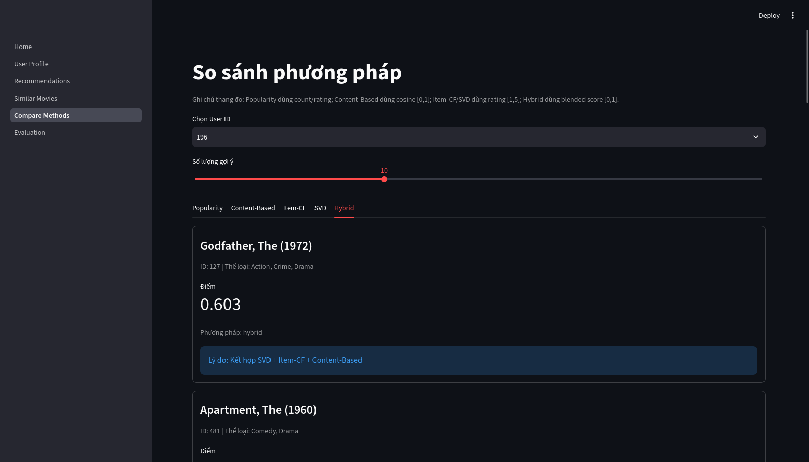
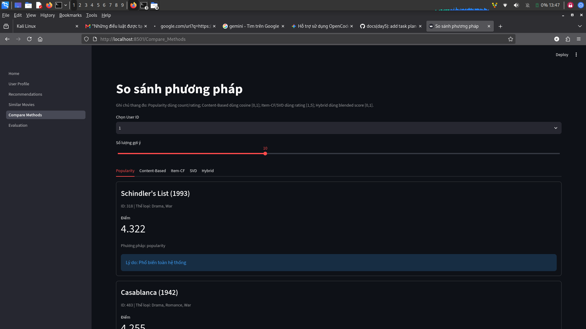

# AI Personalized Recommendation System

Hệ thống gợi ý phim cá nhân hóa xây dựng trên bộ dữ liệu **MovieLens 100K**, triển khai pipeline end-to-end: **data → model → service → giao diện Streamlit**.

## Mục tiêu dự án

- Xây dựng pipeline dữ liệu sạch, chia train/test theo chuẩn `u1.base` / `u1.test` (80.000/20.000), chống leakage.
- Triển khai 5 phương pháp gợi ý: Popularity, Content-Based, Item-CF, SVD, Hybrid.
- Đánh giá bằng rating metrics (RMSE/MAE) và ranking metrics (Precision@K, Recall@K, NDCG@K, Coverage@K).
- Cung cấp giao diện web để chọn user/phim, xem top-K gợi ý, phim tương tự, so sánh phương pháp và xem kết quả đánh giá.

## Quickstart

### 1. Cài dependencies

Yêu cầu Python 3.11.

```bash
python3.11 -m venv .venv
source .venv/bin/activate  # Windows: .venv\Scripts\activate
pip install -r requirements.txt
```

### 2. Chuẩn bị dữ liệu

Tải và xử lý MovieLens 100K, tạo các file Parquet trong `data/processed/` và split train/test:

```bash
python -m src.data.download
python -m src.data.preprocess
python -m src.data.splits
```

### 3. Chạy ứng dụng

```bash
streamlit run app/Home.py
```

### 4. Chạy test và đánh giá

```bash
# Unit tests và lint
pytest -q
ruff check .

# Rating prediction (Popularity, SVD)
python scripts/run_baseline.py
python scripts/run_svd_eval.py

# Ranking metrics (5 phương pháp)
python scripts/run_ranking_eval.py

# Smoke tests
python scripts/smoke_content_based.py
python scripts/smoke_item_cf.py
python scripts/smoke_svd_hybrid.py
```

Kết quả đánh giá được lưu tại `reports/metrics/baseline.json`, `reports/metrics/svd.json`, `reports/metrics/ranking.json`.

## Kiến trúc hệ thống

Luồng chính của hệ thống: **App → Service → Models**. Giao diện Streamlit không import trực tiếp `src.models`, mọi truy cập dữ liệu và suy luận đi qua `RecommenderService`.



### Các lớp chính

- **Data layer (`src/data`)**: tải dữ liệu, chuẩn hóa schema, validate, lưu Parquet, chia train/test.
- **Model layer (`src/models`)**: các recommender tuân theo contract chung (`fit`, `recommend`, `similar_items`), trả về `movie_id`, `title`, `score`, `method`, `reason`.
- **Evaluation layer (`src/evaluation`)**: tính rating metrics và ranking metrics; kết quả ghi ra `reports/metrics/`.
- **Service layer (`src/service`)**: `RecommenderService` là điểm truy cập duy nhất cho UI (load dữ liệu, quản lý model, xử lý fallback, cung cấp metrics).
- **Presentation layer (`app/`)**: Streamlit app gồm Home, Recommendations, Similar Movies, Compare Methods, Evaluation.

## Phương pháp gợi ý

| Phương pháp | Method key | Mô tả ngắn |
|---|---|---|
| Popularity | `popularity` | Xếp hạng theo độ phổ biến (Bayesian average / số lượng rating); dùng làm baseline và fallback. |
| Content-Based | `content_based` | Dựa trên đặc trưng thể loại phim (18 genres), cosine similarity, hồ sơ user từ train. |
| Item-based Collaborative Filtering | `item_cf` | Dựa trên độ tương đồng item-item (adjusted cosine) từ tương tác train. |
| Matrix Factorization (SVD) | `svd` | Phân rã ma trận rating (latent factors) để dự đoán điểm và xếp hạng. |
| Hybrid | `hybrid` | Kết hợp tín hiệu từ SVD, Item-CF và Content-Based (recommend/similar có trọng số riêng). |

## Kết quả đánh giá

Protocol: train-only fit, test dùng một lần để đánh giá (không tune trên test). Ranking dùng relevance `rating >= 4.0`, `K = 5/10/20` (K chính 10), macro-average trên 456 users có relevant item, 487 users bị bỏ qua; coverage tính trên catalog.

### Rating Prediction (RMSE / MAE)

| Model | RMSE | MAE | Nguồn |
|---|---:|---:|---|
| Popularity (Bayesian average) | 1.0669849661484991 | 0.8630965089060417 | `reports/metrics/baseline.json` (giữ nguyên baseline Day 1) |
| SVD | 0.956119767639409 | 0.7524468775134182 | `reports/metrics/svd.json` |

SVD cải thiện khoảng 10,39% RMSE và 12,82% MAE so với Popularity (`n_factors=100`, `n_epochs=20`, `lr_all=0.005`, `reg_all=0.02`, `seed=42`).

### Ranking Metrics (5 phương pháp, K chính = 10)

| Model | Precision@5 | Precision@10 | Recall@10 | NDCG@10 | Coverage@10 |
|---|---:|---:|---:|---:|---:|
| Popularity | 0.163158 | 0.164474 | 0.070910 | 0.174714 | 0.023187 |
| Content-Based | 0.058772 | 0.047368 | 0.022264 | 0.055068 | 0.237812 |
| Item-CF | 0.028947 | 0.029167 | 0.018530 | 0.031481 | 0.508323 |
| SVD | 0.136842 | 0.127851 | 0.048426 | 0.137267 | 0.105826 |
| Hybrid | 0.108333 | 0.100658 | 0.040805 | 0.109632 | 0.315101 |

Nhận xét: Popularity dẫn đầu NDCG@10; Item-CF dẫn đầu Coverage@10. SVD cải thiện rating prediction nhưng không vượt Popularity về ranking trên split này. Hybrid nằm giữa các component về NDCG@10 và tăng coverage so với SVD. Nguồn: `reports/metrics/ranking.json`.

### Biểu đồ đánh giá

| Rating | Ranking accuracy |
|---|---|
|  |  |

| Coverage | Trade-off |
|---|---|
|  |  |

## Demo

### Dữ liệu mẫu sử dụng trong demo

- **User:** 1, 196, 405
- **Phim:** 1 (Toy Story, 1995), 50 (Star Wars, 1977), 56 (Pulp Fiction, 1994)

### Luồng demo gợi ý

- Chọn user và phương pháp (Popularity / Content-Based / Item-CF / SVD / Hybrid) để xem Top-K gợi ý.
- Chọn phim để xem Similar Movies theo SVD và Hybrid (và các phương pháp hỗ trợ tương ứng).
- So sánh 5 phương pháp trên cùng một user tại trang Compare Methods.
- Xem RMSE/MAE và ranking metrics tại trang Evaluation.

### Fallback cases

- **User mới / user không tồn tại / user không có lịch sử trong train:** hệ thống fallback về Popularity, hiển thị `method`/`reason` phản ánh thực tế.
- **User thưa dữ liệu hoặc phim thiếu tín hiệu tương tác:** model có thể không đủ tín hiệu; service áp dụng fallback phù hợp (thường về Popularity) để vẫn trả kết quả.
- **`exclude_seen=True`:** không trả về các phim user đã xem trong lịch sử.

### Ảnh chụp giao diện

| Trang | Ảnh |
|---|---|
| Home |  |
| Recommendations |  |
| Similar Movies |  |
| Compare Methods |  |
| Evaluation |  |

## Dataset

- **MovieLens 100K** (GroupLens): 100.000 ratings, 943 users, 1.682 movies.
- Explicit feedback, thang điểm 1–5. Split chuẩn `u1.base` (80.000) / `u1.test` (20.000).
- Độ thưa xấp xỉ 93,7%.
- Nguồn: <https://files.grouplens.org/datasets/movielens/ml-100k.zip>
- Sử dụng theo điều khoản của GroupLens; dữ liệu raw/processed và artifacts không được commit.

## Hạn chế và hướng phát triển

### Hạn chế

- Dữ liệu MovieLens 100K (1997–1998) không phản ánh sở thích hiện tại; chỉ có explicit feedback, thiếu implicit signals (click, thời gian xem).
- Chỉ đánh giá trên một split/seed cố định; chưa có kiểm định thống kê hay cross-validation.
- Đặc trưng nội dung chỉ dựa trên genre (thô), chưa khai thác mô tả, diễn viên, poster.
- Dữ liệu thưa (~93,7%) và có popularity bias; các model có trade-off giữa độ chính xác ranking, rating prediction và coverage.
- Thang điểm `score` khác nhau giữa các phương pháp (count/rating, cosine, predicted rating, blended score) nên không so sánh trực tiếp giá trị score.

### Hướng phát triển

- Bổ sung implicit feedback và đặc trưng nội dung phong phú (metadata, embedding).
- Thử nghiệm thêm mô hình (ALS, Neural CF, two-tower) và chiến lược hybrid/re-ranking.
- Đánh giá đa split, phân tích độ ổn định và fairness/bias.
- Cải thiện trải nghiệm demo (giải thích gợi ý, latency, logging/monitoring).

## Phân công nhóm

| Thành viên | Vai trò chính | Nội dung phụ trách tiêu biểu |
|---|---|---|
| Huy (Trưởng nhóm) | Integration & Final report | Tích hợp, kiểm chứng, báo cáo tổng hợp, review/merge, điều phối demo |
| Phong | Data & Evaluation | Pipeline dữ liệu, protocol đánh giá, chạy metrics, phân tích kết quả và biểu đồ |
| Linh | Product & Demo | Ứng dụng Streamlit, trải nghiệm người dùng, README, screenshot, kịch bản demo/slide |

## Tài liệu và ghi chú

- Báo cáo cuối: [notes/day5_report.md](notes/day5_report.md)
- Đánh giá cuối: [notes/day5_eval.md](notes/day5_eval.md)
- Review tích hợp: [notes/day5_review.md](notes/day5_review.md)
- Closeout dự án: [notes/day5_closeout.md](notes/day5_closeout.md)
- Chi tiết xác minh của Phong: [notes/day5_phong_details.md](notes/day5_phong_details.md)
- Release cuối: [v1.0.1](https://github.com/Huydcpy/AI-PERSONALIZED_RECOMMENDATION_SYSTEM-/releases/tag/v1.0.1)
- Protocol đánh giá: `docs/evaluation_protocol.md`
- Data card: `docs/data_card.md`
- Ghi chú theo ngày: `notes/day1_report.md`, `notes/day2_eval.md`, `notes/day3_eval.md`, `notes/day4_report.md`, `notes/day4_eval.md`
- Kịch bản demo: [notes/demo_script.md](notes/demo_script.md)
- Dàn ý slide: [notes/day5_slides.md](notes/day5_slides.md)
- Metrics: `reports/metrics/baseline.json`, `reports/metrics/svd.json`, `reports/metrics/ranking.json`
