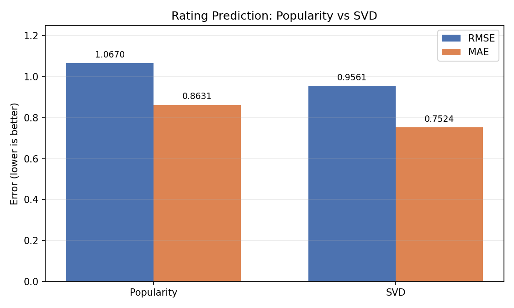
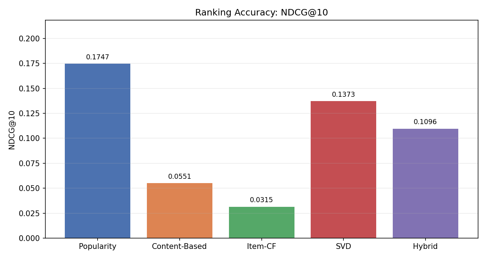
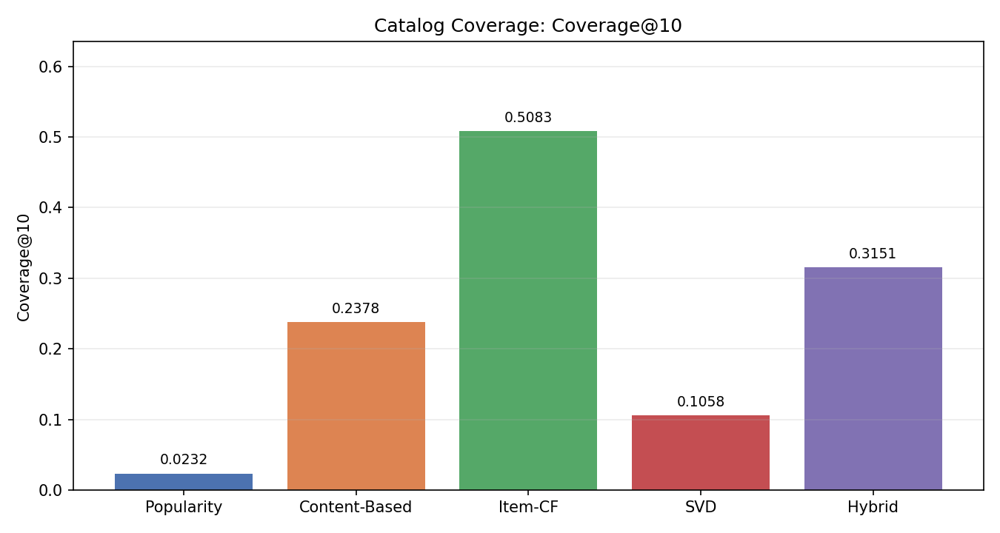
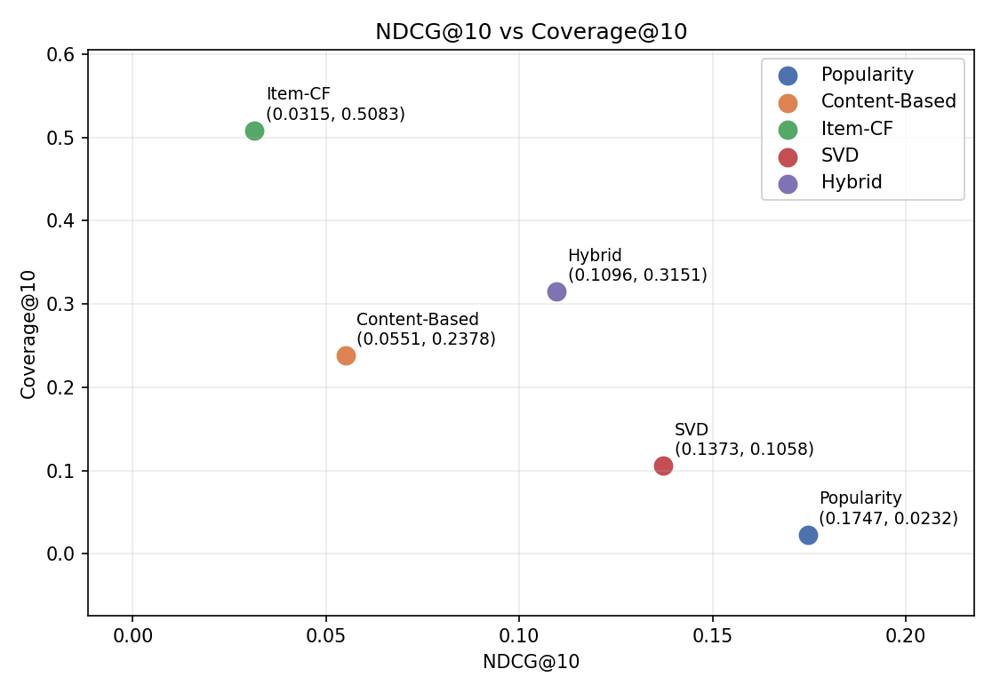

# Đánh giá cuối Day 5 — tổng hợp

Ngày 11/11/2026. Base tích hợp: `main` sau PR #19. Nguồn số liệu: `reports/metrics/baseline.json`, `reports/metrics/svd.json`, `reports/metrics/ranking.json`. Phần tổng hợp dựa trên evaluator và ghi chú Day 4 của Phong; Huy kiểm chứng lại và hợp nhất cho báo cáo cuối.

## Protocol

- Fit chỉ trên 80.000 ratings train; 20.000 ratings test chỉ dùng để đánh giá.
- SVD: `n_factors=100`, `n_epochs=20`, `lr_all=0.005`, `reg_all=0.02`, `random_state=42`.
- Hybrid: recommend `svd=0.5`, `item_cf=0.3`, `content_based=0.2`; similar `item_cf=0.4`, `svd=0.3`, `content_based=0.3`.
- Ranking: relevance `rating >= 4.0`; K `5/10/20`, K chính `10`; macro-average trên 456 user có relevant item; 487 user không có relevant item bị bỏ qua.
- Coverage@10 tính trên toàn catalog 1.682 phim.
- Không tune hyperparameter, trọng số, threshold hoặc K trên test.

## Rating prediction

| Model | RMSE | MAE | Ghi chú |
|---|---:|---:|---|
| Popularity | 1.066985 | 0.863097 | Baseline Day 1, giữ nguyên |
| SVD | 0.956120 | 0.752447 | Fit train-only, clip [1,5] |

SVD giảm khoảng **10,39% RMSE** và **12,82% MAE** so với Popularity. Đây là cải thiện trên bài toán dự đoán rating; không đồng nghĩa SVD dẫn đầu ranking.



## Ranking metrics

| Model | Precision@5 | Precision@10 | Recall@10 | NDCG@10 | Coverage@10 |
|---|---:|---:|---:|---:|---:|
| Popularity | 0.163158 | 0.164474 | 0.070910 | 0.174714 | 0.023187 |
| Content-Based | 0.058772 | 0.047368 | 0.022264 | 0.055068 | 0.237812 |
| Item-CF | 0.028947 | 0.029167 | 0.018530 | 0.031481 | 0.508323 |
| SVD | 0.136842 | 0.127851 | 0.048426 | 0.137267 | 0.105826 |
| Hybrid | 0.108333 | 0.100658 | 0.040805 | 0.109632 | 0.315101 |

Thứ hạng NDCG@10: Popularity → SVD → Hybrid → Content-Based → Item-CF. Thứ hạng Coverage@10: Item-CF → Hybrid → Content-Based → SVD → Popularity.







## Phân tích

- **Popularity** dẫn đầu NDCG@10 và Precision/Recall@10 trên split này, nhưng chỉ phủ khoảng 2,32% catalog. Mô hình tận dụng popularity bias của MovieLens.
- **SVD** cải thiện rõ rating prediction nhưng NDCG@10 chỉ đạt 0,137267, thấp hơn Popularity. Dự đoán rating tốt không đảm bảo xếp hạng top-K tốt.
- **Hybrid** đạt NDCG@10 0,109632 và Coverage@10 0,315101; dung hòa giữa SVD và Item-CF nhưng chưa vượt SVD/Popularity về NDCG@10. Kết quả cho thấy trade-off giữa accuracy và đa dạng, không có bằng chứng Hybrid tốt nhất mọi tiêu chí.
- **Item-CF** có coverage cao nhất (0,508323) nhưng NDCG@10 thấp nhất (0,031481), phù hợp với dữ liệu thưa và tín hiệu item-item còn yếu.
- **Content-Based** có coverage 0,237812 nhưng NDCG@10 0,055068; đặc trưng genre thô tạo nhiều tie và chưa đủ phân biệt sở thích.
- 487/943 user bị bỏ khỏi ranking metrics do không có relevant item trong test; kết quả đại diện nhóm user có relevant item, không phải toàn bộ người dùng.

## Fallback và kiểm chứng

- User 999999 fallback Popularity với reason cold-start.
- User metadata-only fallback Popularity.
- Phim zero-interaction: SVD similar fallback Popularity.
- Movie ID không tồn tại raise `ValueError`.
- `exclude_seen=True` không trả phim đã xem trong top-10.
- SVD vector hóa khớp Surprise trên các cặp known; sai số tối đa khoảng `8,88e-16`.
- Kết quả gọi lại cho 3 user và 3 phim giống nhau; evaluator tái lập SHA-256.
- AppTest xác nhận 5 phương pháp, Compare 5 tab/50 card, Evaluation 2 bảng.

## Tái lập

```bash
pytest -q
ruff check .
python scripts/run_svd_eval.py
python scripts/run_ranking_eval.py
python scripts/smoke_svd_hybrid.py
python scripts/make_day5_figures.py
```

Kết quả local: 106 test pass; lint pass; SVD evaluation khoảng 1,42 giây; ranking evaluation khoảng 15,09 giây; warm service khoảng 0,09 giây cho 12 lời gọi; Streamlit trả HTTP 200. Baseline Day 1 không thay đổi.

## Hạn chế

- MovieLens 100K có từ 1997–1998, chủ yếu explicit feedback, độ thưa khoảng 93,7%.
- Một split và một seed; chưa có cross-validation hoặc kiểm định thống kê.
- Chưa có implicit feedback, metadata phong phú hoặc fairness analysis.
- Score giữa các phương pháp khác thang đo nên không so sánh trực tiếp.
- Kết quả ranking không đại diện cho 487 user không có relevant item trong test.

## Kết luận

Hệ thống đã có đủ 5 phương pháp, đánh giá rating và ranking, fallback rõ ràng và app demo end-to-end. Kết quả thực tế cho thấy Popularity vẫn là baseline mạnh về NDCG@10, SVD cải thiện rating, Item-CF tăng coverage, còn Hybrid là điểm cân bằng nhưng chưa vượt các baseline về accuracy. Báo cáo tổng hợp: [day5_report.md](day5_report.md).

## Phong hoàn thiện Day 5 — xác minh ngày 10/11/2026

Phần tổng hợp phía trên là hồ sơ tích hợp có sẵn. Lần xác minh này thực hiện trên base `20178b4`; các mốc thời gian chạy trong hồ sơ cũ không phải phép đo mới. Nguồn trực tiếp: [baseline.json](../reports/metrics/baseline.json), [svd.json](../reports/metrics/svd.json), [ranking.json](../reports/metrics/ranking.json).

[Bảng chi tiết và số liệu dự phòng](day5_phong_details.md) gồm chênh lệch rating tuyệt đối/phần trăm, thứ hạng từng cột ranking, Top-5 đủ 5 phương pháp cho user 196, Similar Movies SVD/Hybrid cho phim 1/50/56 và reason fallback thực tế.

### Đối chiếu và phân tích ví dụ

- SVD giảm RMSE **0,110865 (10,3905%)**, MAE **0,110650 (12,8201%)** so với baseline. Các số làm tròn từ JSON, không sửa metrics gốc.
- Với Precision@5, Precision@10, Recall@10 và NDCG@10, thứ tự đều là Popularity → SVD → Hybrid → Content-Based → Item-CF. Coverage@10 có thứ tự Item-CF → Hybrid → Content-Based → SVD → Popularity.
- User 196: Popularity trả Schindler's List, Star Wars, Casablanca; đây là baseline điểm Bayesian dùng tín hiệu toàn hệ thống, không nên diễn giải đơn thuần là đếm lượt xem.
- Content-Based trả cả 5 phim cùng score 0,913554 và reason Comedy/Drama. Tie làm giảm khả năng phân biệt nội dung sâu hơn; thứ tự phụ thuộc tie-break movie ID.
- Item-CF trả cả 5 score 5,000000 sau clip. Coverage cao không bảo đảm precision cao; dữ liệu thưa và dự đoán bị clip là các giả thuyết giải thích, chưa có thí nghiệm ablation chứng minh nguyên nhân.
- SVD similar cho Toy Story trả Eat Drink Man Woman (45) ở đầu, thể hiện latent similarity không ràng buộc genre hoạt hình. Không có nhãn hài lòng để kết luận đây là gợi ý sai cho từng người.
- Hybrid Top-5 user 196 giao 3 phim với SVD nhưng đứng đầu bằng Godfather (127). NDCG@10 thấp hơn SVD trong khi coverage cao hơn; việc pha tín hiệu có thể làm loãng tín hiệu ranking mạnh, chưa chứng minh quan hệ nhân quả.
- Coverage là tỷ lệ phim khác nhau được gợi ý trên toàn nhóm user, không phải phép đo diversity trong từng danh sách hay mức hài lòng.

### Fallback và lỗi

Smoke SVD/Hybrid kiểm tra user lạ 999999, user metadata-only 196 sau khi loại ratings của user khỏi train tạm, và movie 1 sau khi loại tương tác khỏi train tạm. Hai case user trả `method="popularity"`, reason `Fallback phổ biến (cold-start)`; SVD similar cho phim zero-interaction trả Popularity với reason `Fallback phổ biến (thiếu tín hiệu)`. Hybrid vẫn có thể dùng metadata của Content-Based cho phim thiếu tương tác nên không khẳng định mọi phim zero-interaction đều fallback. ID phim không tồn tại gây `ValueError` đúng dự kiến.

### Kiểm chứng và bàn giao

- 42 test thuộc SVD, Hybrid và ranking evaluator đạt; Ruff đạt. Smoke SVD/Hybrid exit code 0, kiểm tra tính lặp lại trên 3 user và 3 phim, sai số vector hóa tối đa `8,88e-16`.
- Đã chạy script biểu đồ hai lần thành công; SHA-256 của từng ảnh khớp giữa hai lần. Bốn PNG đều dưới 1 MB; biểu đồ trade-off được bổ sung nhãn giá trị. Script kiểm tra đúng model và metric hữu hạn trước khi vẽ, chỉ đọc JSON metrics.
- Không thay đổi model, hyperparameter, trọng số, threshold hoặc K; không tune trên test. Một split/seed, chưa kiểm định thống kê; không thực hiện bootstrap tùy chọn.
- Tài liệu và 4 hình đã sẵn sàng để Huy/Linh sử dụng. Chưa có xác nhận review trực tiếp của Huy trong phiên làm việc này; không ghi nhận thay approval hay khẳng định đã bàn giao qua tin nhắn.

### Q&A cho Phong

1. **Vì sao Popularity có NDCG@10 cao nhất?** Trên split này, danh sách điểm phổ biến khớp nhiều relevant item và đứng đầu với 0,174714. Popularity bias là cách giải thích hợp lý, chưa được kiểm chứng bằng thí nghiệm riêng; coverage chỉ 0,023187.
2. **Vì sao SVD RMSE tốt hơn nhưng ranking thấp hơn?** RMSE đo sai số rating trên các cặp test đã quan sát; NDCG đo vị trí relevant item trong danh sách phim chưa xem. Hai mục tiêu và tập ứng viên khác nhau nên cải thiện mục tiêu này không bảo đảm cải thiện mục tiêu kia.
3. **Coverage cao có tốt hơn không?** Item-CF phủ 50,8323% catalog nhưng NDCG chỉ 0,031481. Coverage cao cho thấy phạm vi tiếp cận rộng hơn, cần xét cùng chất lượng ranking và không đồng nghĩa ít bias hơn ở mọi khía cạnh.
4. **Hybrid có tốt nhất không?** Không. NDCG 0,109632 thấp hơn SVD 0,137267; coverage 0,315101 cao hơn SVD 0,105826. Đây là đánh đổi quan sát được, không chọn lại trọng số theo test.
5. **Nếu demo lỗi hoặc bị hỏi độ tin cậy?** Dùng bảng chi tiết và 4 hình liên kết ở trên. Nêu rõ 456 user được đánh giá, 487 user bị bỏ vì thiếu relevant item; kết quả từ một split/seed, chưa kiểm định thống kê và chưa chứng minh hiệu quả trên người dùng thực.
