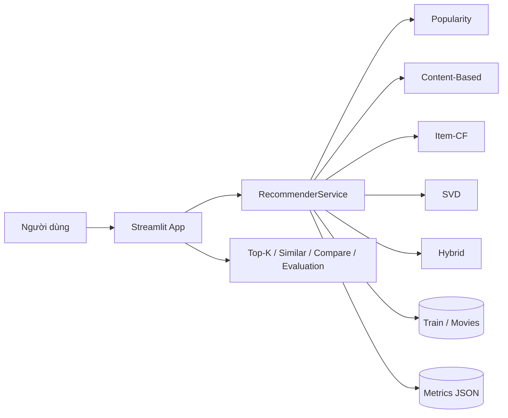
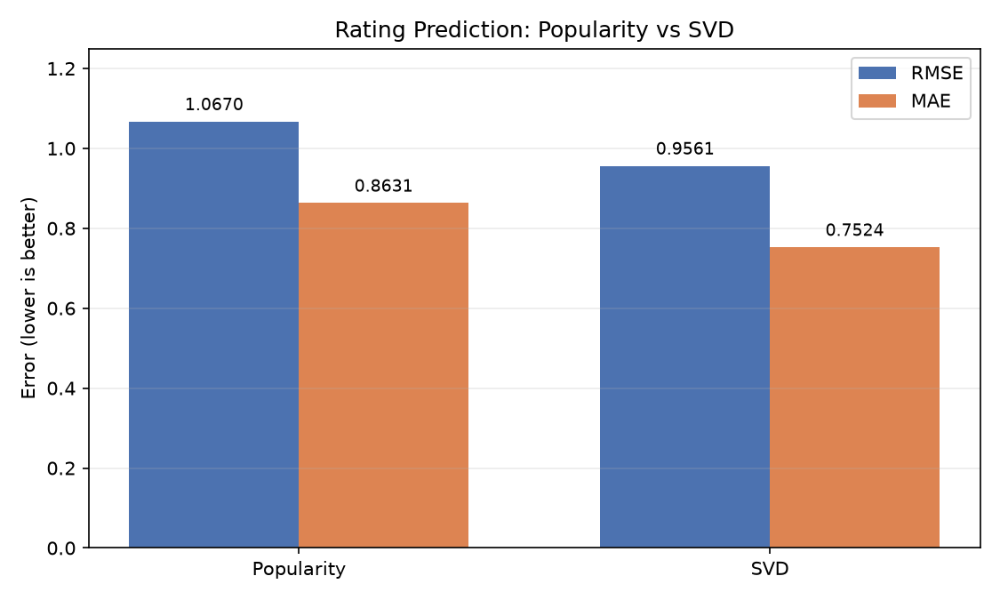
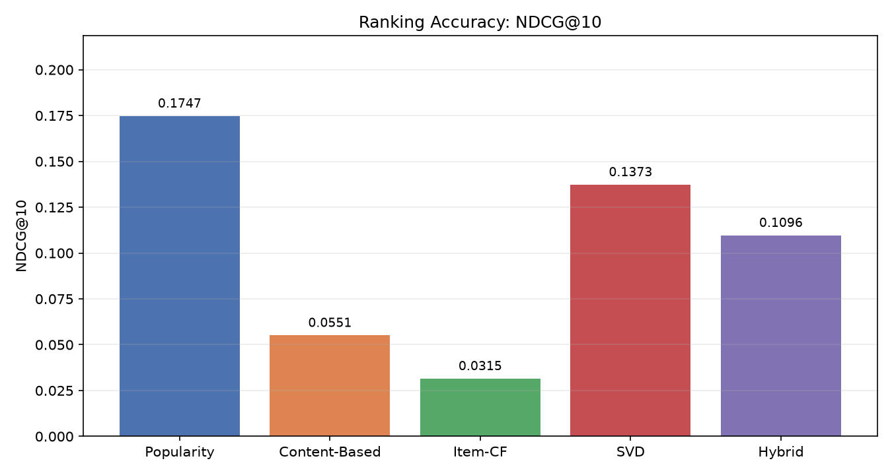
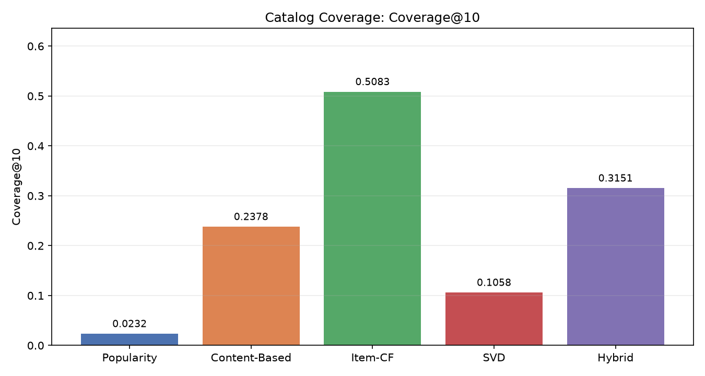
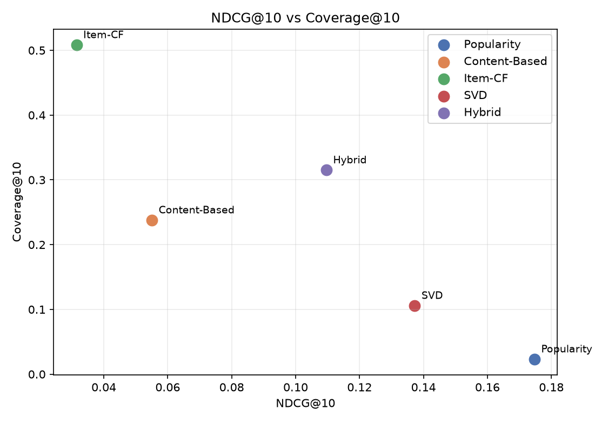

# Báo cáo tổng kết — AI Personalized Recommendation System

**Ngày:** 11/11/2026  
**Dataset:** MovieLens 100K  
**Thành viên:** Huy (Trưởng nhóm), Phong, Linh  
**Base tích hợp:** `main` sau PR #19  
**Tài liệu liên quan:** [Đánh giá cuối](day5_eval.md), [Review tích hợp](day5_review.md), [Kịch bản demo](demo_script.md), [Dàn ý slide](day5_slides.md), [README](../README.md)

## 1. Tóm tắt

Dự án xây dựng hệ thống gợi ý phim cá nhân hóa end-to-end trên MovieLens 100K: data pipeline → 5 phương pháp gợi ý → service → giao diện Streamlit. Hệ thống hỗ trợ Popularity, Content-Based, Item-CF, SVD và Hybrid; có đánh giá rating (RMSE/MAE), đánh giá ranking (Precision@K, Recall@K, NDCG@K, Coverage@K), fallback cold-start và giao diện so sánh trực quan.

Kết quả chính trên split `u1`:

- SVD cải thiện rating so với Popularity: RMSE `0.956120` so với `1.066985`; MAE `0.752447` so với `0.863097`.
- Popularity dẫn đầu NDCG@10 (`0.174714`), SVD đứng thứ hai (`0.137267`), Hybrid `0.109632`.
- Item-CF dẫn đầu Coverage@10 (`0.508323`); Hybrid `0.315101`; Popularity chỉ `0.023187`.
- Không có phương pháp tốt nhất mọi tiêu chí; kết quả thể hiện trade-off rõ giữa rating accuracy, ranking accuracy và catalog coverage.

## 2. Bài toán và mục tiêu

Bài toán: từ lịch sử rating explicit của người dùng, dự đoán mức độ phù hợp và xếp hạng top-K phim chưa xem. Dữ liệu thưa, popularity bias và cold-start là các thách thức chính.

Mục tiêu:

- Xây dựng pipeline dữ liệu tái lập, chia train/test chuẩn, chống leakage.
- Triển khai và so sánh 5 phương pháp gợi ý trong cùng một contract.
- Đánh giá bằng rating metrics và ranking metrics; không tune trên test.
- Cung cấp giao diện demo: xem gợi ý, phim tương tự, so sánh phương pháp và kết quả đánh giá.
- Báo cáo trung thực cả kết quả tốt và hạn chế.

## 3. Dữ liệu và tiền xử lý

| Thành phần | Giá trị |
|---|---:|
| Ratings | 100.000 |
| Users | 943 |
| Movies | 1.682 |
| Train (`u1.base`) | 80.000 |
| Test (`u1.test`) | 20.000 |
| Thang điểm | 1–5 |
| Độ thưa | khoảng 93,7% |
| Seed | 42 |

Pipeline:

1. Tải MovieLens 100K từ GroupLens.
2. Chuẩn hóa schema ratings/movies/users, validate khóa và giá trị.
3. Lưu Parquet trong `data/processed/`.
4. Chia train/test theo `u1.base` / `u1.test`.
5. Fit model chỉ trên train; test chỉ dùng một lần để đánh giá.

Không commit dữ liệu raw/processed, model artifact hoặc cache.

## 4. Kiến trúc hệ thống



- **Data layer:** download, preprocess, validate, split.
- **Model layer:** 5 recommender tuân theo contract chung; trả `movie_id`, `title`, `score`, `method`, `reason`.
- **Evaluation layer:** rating metrics và ranking metrics; ghi JSON qua file tạm.
- **Service layer:** điểm truy cập duy nhất cho UI; quản lý model, fallback, metrics.
- **Presentation layer:** Streamlit Home, Recommendations, Similar Movies, Compare Methods, Evaluation.

App không import trực tiếp `src.models`; service dùng `cache_resource`, metrics dùng `cache_data`.

## 5. Phương pháp

### 5.1 Popularity

Xếp hạng theo độ phổ biến (Bayesian average/count). Là baseline Day 1 và fallback cho cold-start/thiếu tín hiệu. Ưu điểm: ổn định, dễ giải thích; nhược điểm: popularity bias, coverage thấp.

### 5.2 Content-Based

Dùng 18 đặc trưng genre, chuẩn hóa L2, cosine similarity. Hồ sơ user lấy từ train, trọng số `max(rating - 3, 0)`. Fallback Popularity khi user/phim thiếu tín hiệu. Đặc trưng genre thô nên dễ tạo tie.

### 5.3 Item-CF

Adjusted cosine trên ma trận user-item đã trừ trung bình user, giữ tối đa 50 láng giềng mỗi item, clip similarity âm. Gợi ý dựa trên weighted centered ratings, clip predicted rating `[1,5]`. Dữ liệu thưa làm precision/NDCG thấp nhưng coverage cao.

### 5.4 SVD

Matrix factorization bằng `surprise.SVD`:

- `n_factors=100`
- `n_epochs=20`
- `lr_all=0.005`
- `reg_all=0.02`
- `random_state=42`

Dự đoán rating `mu + b_u + b_i + p_u·q_i`, clip `[1,5]`. Similar Movies dùng cosine trên item latent factors; phim không có factor fallback Popularity.

### 5.5 Hybrid

Kết hợp SVD + Item-CF + Content-Based:

- Recommend: `svd=0.5`, `item_cf=0.3`, `content_based=0.2`.
- Similar: `item_cf=0.4`, `svd=0.3`, `content_based=0.3`.
- Pool `max(50, 3*K)`.
- Min-max normalize từng component; chỉ blend item native; item vắng đóng góp 0.
- Fallback Popularity sau blend nếu thiếu item.

## 6. Giao thức đánh giá

- Train-only fit; test chỉ dùng đánh giá cuối.
- Rating: RMSE, MAE trên 20.000 cặp test.
- Ranking: relevance `rating >= 4.0`; K `5/10/20`, K chính `10`.
- Macro-average trên 456 user có ít nhất một relevant item; 487 user không có relevant item bị bỏ qua.
- Coverage@10 trên toàn catalog 1.682 phim.
- Không tune hyperparameter, trọng số, threshold hoặc K trên test.
- Kết quả ghi tự động vào JSON; không sửa tay.

## 7. Kết quả rating prediction

| Model | RMSE | MAE |
|---|---:|---:|
| Popularity | 1.066985 | 0.863097 |
| SVD | 0.956120 | 0.752447 |

SVD giảm khoảng **10,39% RMSE** và **12,82% MAE** so với Popularity. Đây là cải thiện trên bài toán dự đoán rating, không đảm bảo ranking tốt hơn.



## 8. Kết quả ranking

| Model | Precision@5 | Precision@10 | Recall@10 | NDCG@10 | Coverage@10 |
|---|---:|---:|---:|---:|---:|
| Popularity | 0.163158 | 0.164474 | 0.070910 | 0.174714 | 0.023187 |
| Content-Based | 0.058772 | 0.047368 | 0.022264 | 0.055068 | 0.237812 |
| Item-CF | 0.028947 | 0.029167 | 0.018530 | 0.031481 | 0.508323 |
| SVD | 0.136842 | 0.127851 | 0.048426 | 0.137267 | 0.105826 |
| Hybrid | 0.108333 | 0.100658 | 0.040805 | 0.109632 | 0.315101 |

- NDCG@10: Popularity → SVD → Hybrid → Content-Based → Item-CF.
- Coverage@10: Item-CF → Hybrid → Content-Based → SVD → Popularity.
- Popularity mạnh nhờ popularity bias nhưng chỉ phủ 2,32% catalog.
- Item-CF phủ 50,83% catalog nhưng NDCG@10 thấp nhất.
- Hybrid cân bằng hơn với NDCG@10 10,96% và coverage 31,51%, nhưng chưa vượt SVD/Popularity về NDCG@10.







## 9. Phân tích và thảo luận

### 9.1 Rating và ranking là hai bài toán khác nhau

SVD tối ưu dự đoán rating nên cải thiện RMSE/MAE, nhưng top-K ranking phụ thuộc thứ tự tương đối và phân bố item. Vì vậy SVD có thể dự đoán rating tốt hơn mà vẫn thấp hơn Popularity về NDCG@10 trên split này.

### 9.2 Popularity bias và coverage

Popularity chỉ phủ khoảng 2,32% catalog nhưng dẫn đầu NDCG@10. Điều này phản ánh dữ liệu MovieLens tập trung vào phim phổ biến. Item-CF và Hybrid tăng coverage nhưng phải đánh đổi accuracy. Báo cáo không kết luận một phương pháp “tốt nhất” tuyệt đối.

### 9.3 Hybrid chưa vượt component

Hybrid kết hợp tín hiệu nhưng bị dilution khi các component đồng thuận thấp. Trọng số được chốt trước đánh giá và không tune trên test; kết quả thấp hơn SVD/Popularity về NDCG@10 là kết quả thực tế, không bị che giấu.

### 9.4 Cold-start và fallback

User lạ, user metadata-only và phim zero-interaction đều fallback Popularity với `method`/`reason` thực tế. Fallback giữ app hoạt động nhưng không giải quyết bản chất cold-start; cần implicit feedback hoặc nội dung phong phú hơn.

### 9.5 Giới hạn thống kê

Kết quả dựa trên một split và một seed. Chưa có cross-validation, bootstrap CI hoặc kiểm định ý nghĩa thống kê. Các so sánh chỉ mang tính mô tả trên split hiện tại.

## 10. Sản phẩm và demo

### 10.1 Chức năng

- Home: tổng quan dataset, 5 phương pháp, baseline metrics.
- User Profile: thông tin user và lịch sử.
- Recommendations: top-K theo 5 phương pháp, hiển thị score/method/reason.
- Similar Movies: phim tương tự theo Content-Based, Item-CF, SVD, Hybrid.
- Compare Methods: 5 tab, so sánh trực quan trên cùng user.
- Evaluation: bảng RMSE/MAE và ranking metrics 5 model.

### 10.2 Ảnh giao diện

| Trang | Ảnh |
|---|---|
| Home | [day5_home.png](../reports/figures/day5_home.png) |
| Recommendations | [day5_recommendations.png](../reports/figures/day5_recommendations.png) |
| Similar Movies | [day5_similar.png](../reports/figures/day5_similar.png) |
| Compare Methods | [day5_compare.png](../reports/figures/day5_compare.png) |
| Evaluation | [day5_evaluation.png](../reports/figures/day5_evaluation.png) |

Ảnh được chụp từ app thật với user 196, movie 1 và method Hybrid; không chỉnh sửa nội dung.

### 10.3 Kịch bản demo

Demo 5–7 phút: Huy mở đầu/kiến trúc, Phong trình bày metrics, Linh demo app và fallback. Chi tiết tại [demo_script.md](demo_script.md); dàn ý slide tại [day5_slides.md](day5_slides.md).

## 11. Kiểm chứng và tái lập

### 11.1 Kết quả local

- `pytest -q`: **106 passed**.
- `ruff check .`: pass.
- Smoke SVD/Hybrid, Item-CF, Content-Based, Surprise: pass.
- SVD evaluation: khoảng 1,42 giây.
- Ranking evaluation: khoảng 15,09 giây.
- Warm service cho 12 lời gọi: khoảng 0,09 giây.
- Streamlit khởi động: HTTP 200.
- AppTest: 5 phương pháp, Compare 5 tab/50 card, Evaluation 2 bảng.

### 11.2 Tái lập số liệu

```bash
pytest -q
ruff check .
python scripts/run_svd_eval.py
python scripts/run_ranking_eval.py
python scripts/smoke_svd_hybrid.py
python scripts/make_day5_figures.py
```

- `reports/metrics/svd.json` và `reports/metrics/ranking.json` tái lập SHA-256.
- `reports/metrics/baseline.json` không thay đổi.
- Số liệu README/report/eval lấy từ JSON.

### 11.3 CI

- PR #18: Day 4 finalization, CI xanh, merge vào `main` tại `066bcd8`.
- PR #19: README/screenshot/demo/slide Day 5, CI xanh tại `b9a8620`, merge vào `main` tại `d0ade04`.
- PR Day 5 final: báo cáo, eval, review, biểu đồ; CI xanh trước merge.
- CI chạy lint, test, app boundary, ranking evaluation, SVD rating evaluation và các smoke test.

## 12. Hạn chế và hướng phát triển

### 12.1 Hạn chế

- MovieLens 100K (1997–1998), explicit feedback, độ thưa cao.
- Một split/seed; chưa có cross-validation hoặc kiểm định thống kê.
- Content-Based chỉ dùng genre thô; chưa có metadata/embedding.
- Popularity bias; 487 user không có relevant item trong test bị bỏ khỏi ranking metrics.
- Score khác thang đo giữa các phương pháp; không so sánh trực tiếp.
- Fallback Popularity chưa giải quyết cold-start thực sự.
- Chưa đánh giá fairness, diversity ngoài coverage, hoặc online A/B test.

### 12.2 Hướng phát triển

- Bổ sung implicit feedback (click, thời gian xem) và negative sampling.
- Dùng metadata phong phú, TF-IDF/embedding cho Content-Based.
- Thử ALS, Neural CF, two-tower, re-ranking.
- Đánh giá đa split, bootstrap CI, fairness và diversity.
- Cải thiện cold-start bằng content/context và fallback thông minh hơn.
- Thêm logging/monitoring và giải thích gợi ý.

## 13. Phân công và bài học

| Thành viên | Đóng góp chính |
|---|---|
| Huy | Data pipeline, SVD/Hybrid, service, tích hợp, kiểm chứng, báo cáo, review/merge, điều phối demo |
| Phong | Protocol đánh giá, ranking/rating evaluation, smoke, phân tích số liệu và biểu đồ |
| Linh | Giao diện Streamlit, README, screenshot, kịch bản demo, slide, PR/CI |

Bài học:

- Chốt protocol và contract trước khi viết model giúp tích hợp nhanh.
- Train-only fit và test dùng một lần là nguyên tắc bắt buộc.
- Fallback tập trung ở service giúp app ổn định và reason nhất quán.
- Kết quả xấu hơn baseline vẫn phải báo cáo; không tune trên test.
- Tách App–Service–Model và test tự động giảm lỗi tích hợp.
- Cần phân tích trade-off thay vì chỉ chọn một metric.

## 14. Tài liệu tham khảo

- GroupLens Research. MovieLens 100K Dataset. <https://grouplens.org/datasets/movielens/100k/>
- Hug, N. Surprise: A Python scikit for recommender systems. <https://surpriselib.com/>
- Streamlit. <https://streamlit.io/>
- Koren, Y., Bell, R., Volinsky, C. Matrix Factorization Techniques for Recommender Systems. IEEE Computer, 2009.
- Sarwar, B., Karypis, G., Konstan, J., Riedl, J. Item-based Collaborative Filtering Recommendation Algorithms. WWW, 2001.
- Lops, P., de Gemmis, M., Semeraro, G. Content-based Recommender Systems: State of the Art and Trends. Recommender Systems Handbook, 2011.

## 15. Phụ lục

### 15.1 Artifacts

- Code: `src/`, `app/`, `scripts/`
- Metrics: `reports/metrics/baseline.json`, `svd.json`, `ranking.json`
- Figures: `reports/figures/day5_*.png`
- Docs: `docs/evaluation_protocol.md`, `docs/data_card.md`
- Notes: `notes/day5_eval.md`, `notes/day5_review.md`, `notes/demo_script.md`, `notes/day5_slides.md`

### 15.2 Lệnh tổng hợp

```bash
python -m src.data.download
python -m src.data.preprocess
python -m src.data.splits
pytest -q
ruff check .
python scripts/run_svd_eval.py
python scripts/run_ranking_eval.py
python scripts/smoke_svd_hybrid.py
python scripts/make_day5_figures.py
streamlit run app/Home.py
```

### 15.3 Trạng thái

- 5 phương pháp tích hợp: hoàn thành.
- Rating/ranking evaluation: hoàn thành.
- App 5 trang: hoàn thành.
- Báo cáo/eval/review: hoàn thành.
- Demo script/slide/screenshot: hoàn thành.
- CI và tái lập: hoàn thành.
